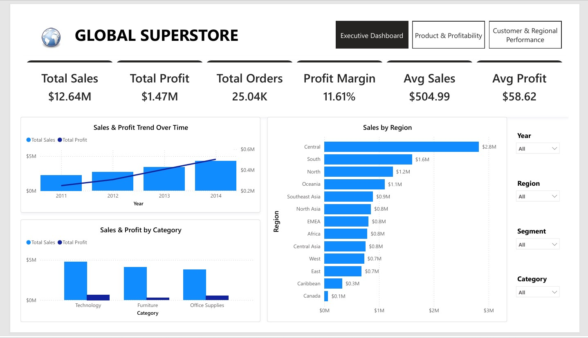

# Advanced Business Intelligence Dashboard – Global Superstore 📊

**Role:** Junior Data Analyst  
**Tool:** Microsoft Power BI  

## Project Overview
This project builds on exploratory analysis to deliver an advanced, multi-page executive dashboard for Global Superstore. The goal is to investigate root causes behind profitability challenges, measure the impact of discounts, and provide strategic recommendations.

## Global Superstore Visualizations

## Business Problems Investigated
1. **Aggressive Discounting:** Identifying how discounts above 20% destroy profit margins.
2. **Loss-Making Products:** Analyzing chronic net losses in the "Tables" sub-category.
3. **Regional Gaps:** Comparing high-margin markets (Central) against underperforming regions.

## Key DAX Measures & KPIs
* **Total Sales:** $12.64M
* **Total Profit:** $1.47M
* **Profit Margin:** 11.61%
* **Total Orders:** 25,035
* **Average Order Value:** $246.49
* **Custom Measures:** Loss-Making Orders, Average Discount, Average Profit per Order.

## Strategic Recommendations
* Enforce a strict 15% discount cap to protect gross margins.
* Restructure or discontinue the unprofitable "Tables" line.
* Shift marketing budgets to capture recurring Q4 sales spikes.

## Tech Stack
* Microsoft Power BI Desktop
* Power Query (ETL)
* DAX (Calculated Measures)
